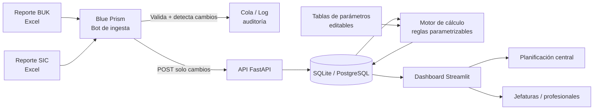

# Plan de Proyecto — Botathon 2026 «Cada hora cuenta»

> **Equipo:** 4 integrantes (Integrante 1 a 4) · **Duración:** 10 horas · **Meta:** MVP funcional + demo de 5 min + pitch de 3 min
> **Desafío:** reemplazar el Excel de planificación asistencial de Teletón por un flujo automatizado, trazable y parametrizable, con **Blue Prism como pieza central**.

> ⚠️ **Nota de alcance:** el documento oficial del desafío habla de **16 horas**. Este plan está comprimido a **10 horas** según lo solicitado. Para que quepa, se prioriza un **flujo vertical completo y demostrable** (BUK → bot → cálculo → dashboard) por sobre la réplica de todas las hojas del Excel. Lo que se recorta está explícito en la sección 3.

---

## 1. El problema en una frase

Hoy la planificación de horas de **más de 600 profesionales** en todos los institutos vive en un Excel alimentado a mano desde BUK y SIC, sin trazabilidad, con reglas escondidas y versiones guardadas como copias con fecha. El desafío es convertir ese Excel en un **sistema que recibe reportes, valida, detecta cambios, recalcula metas y muestra el consolidado nacional**.

**Usuario principal:** equipo de planificación central de Teletón (ve todos los institutos).
**Usuarios secundarios:** jefaturas de instituto y profesionales (consulta de su planificación).

---

## 2. Propuesta de solución

### 2.1 Idea fuerza

> **El bot recibe, valida y compara. La aplicación parametriza, calcula y muestra.**

Blue Prism no es un adorno: es la puerta de entrada obligatoria de los datos. El bot:

1. Detecta el reporte BUK/SIC en una carpeta vigilada.
2. Lo lee, normaliza y valida (columnas, tipos, fechas, horas, duplicados, cargos desconocidos).
3. Compara contra la última versión cargada y **detecta altas, bajas y cambios** (jornada, cargo, vigencia, reemplazos).
4. Envía solo lo que cambió a la API de la aplicación y deja un **log de auditoría**.
5. Reporta errores en un archivo/vista de calidad de datos, sin cargar datos inválidos.

La aplicación (Python + Streamlit) recibe esos datos, aplica las **reglas parametrizables**, calcula la planificación por profesional/mes y expone dashboards con filtros nacional → instituto → área → profesional.

### 2.2 Por qué Blue Prism es la herramienta correcta

- El proceso real es **repetitivo y basado en archivos**: llegar, leer, validar y comparar reportes.
- El bot deja **evidencia visible** de su aporte en la demo (cola, log, reporte de validación).
- Separa la **automatización operativa** (bot) del **criterio humano y la parametrización** (aplicación), tal como sugiere la pista del desafío.

### 2.3 Arquitectura objetivo



**Flujo de demo:** se reemplaza el Excel de BUK por uno con un cambio (ej. aumento de jornada de un profesional) → el bot lo procesa → la app detecta el cambio → recalcula → el dashboard muestra el efecto en metas y FOJA.

---

## 3. Alcance del MVP para 10 horas

### 3.1 Obligatorio (Must) — lo que se construye sí o sí

| # | Requisito | Cómo se cumple |
|---|-----------|----------------|
| M1 | Blue Prism en el centro | Proceso BP que lee BUK, valida, detecta cambios y envía a la API. Visible en demo. |
| M2 | Datos sin copiar/pegar | Carga desde carpeta vigilada + API. Cero intervención manual de datos. |
| M3 | Reglas parametrizables | Tablas de parámetros en BD editables desde la UI (%, minutos, asignaciones, calendario, meta 90%). |
| M4 | Cálculo correcto | Motor por profesional/mes calibrado contra 2–3 casos del Excel de referencia. |
| M5 | Cambios durante el año | Diff contra snapshot anterior + vigencia desde el mes que rige + recálculo. |
| M6 | Visibilidad | Dashboard nacional con filtros por instituto, área, cargo, mes y profesional. |
| M7 | KPIs del desafío | **Meta de Gestión = atenciones planificadas × 90%** y **FOJA = horas directas disponibles / horas contratadas**. |

### 3.2 Deseable (Should) — solo si el núcleo ya funciona

- Comparación planificado vs. ejecutado (SIC) con alertas de desviación.
- Trazabilidad: quién/cuándo/qué cambió y por qué (log + versión).
- Multi-instituto (hoja Excepciones), reemplazos y vacantes.
- Simulación de cambio de parámetro antes de aplicar.
- Exportación a Excel/PDF y accesibilidad (contraste, navegación por teclado, resumen textual).

### 3.3 Fuera de alcance (Won't) en 10 horas

- Réplica exacta de las 8 hojas del Excel y de todos los casos borde.
- Autenticación corporativa (SSO/AD), despliegue productivo, alta disponibilidad.
- Distribución automática de reportes por correo a jefaturas.
- Flujo completo de aprobación de asignaciones (solo se deja el campo y la regla).
- Integración real con APIs de BUK/SIC (no existen para la Botathon).

### 3.4 Criterios de éxito (Definition of Victory)

1. La demo corre **de punta a punta sin intervención manual** en menos de 5 minutos.
2. Un reporte BUK nuevo con un cambio de jornada **se procesa y se refleja en el dashboard**.
3. El cálculo de al menos **2 casos de prueba coincide con el Excel** (tolerancia ±1 atención por redondeo).
4. Se pueden cambiar 3 parámetros desde la UI y ver el recálculo **sin tocar código**.
5. El pitch de 3 minutos explica problema, solución, rol de BP, viabilidad e impacto.

---

## 4. Equipo: 4 roles y responsabilidades

| Rol | Integrante | Responsabilidad principal | Entregable clave | Backup |
|-----|------------|---------------------------|------------------|--------|
| **A. Bot / Integración** | **Integrante 1** | Blue Prism, ingesta BUK/SIC, validaciones, API, logs, manejo de la VM | Proceso BP + endpoint de ingesta + log | Integrante 4 |
| **B. Motor / Datos** | **Integrante 2** | Modelo de datos, ETL, reglas de cálculo, parámetros, tests | Motor de cálculo + BD + suite de pruebas | Integrante 1 |
| **C. Producto / Dashboard** | **Integrante 3** | UI, filtros, KPIs, visualizaciones, accesibilidad, export | Dashboard nacional/instituto/profesional | Integrante 4 |
| **D. Negocio / QA / Pitch** | **Integrante 4** | Ingeniería inversa del Excel, casos de prueba, calidad de datos, guion demo, pitch, control de tiempo | Casos de prueba + validación + deck + guion | Integrante 2 |

> La asignación es arbitraria: cada integrante puede asumir su rol sin problema. Lo importante es respetar el backup y no dejar ninguna workstream sin dueño. Si alguien termina antes, ayuda al workstream más atrasado (especialmente al Bot en las primeras 2 horas).

**Regla de oro:** nadie trabaja solo en la ruta crítica. Cada workstream tiene un backup que puede retomarlo en 15 minutos (documentado en el README).

### 4.1 Acuerdos de trabajo

- **Standup de 5 min** al inicio de cada bloque y **checkpoint de 10 min** al cierre.
- **Tablero único** (GitHub Projects / Trello) con columnas: Backlog → En curso → En revisión → Hecho.
- **Commits pequeños y frecuentes**; integrar a `main` en cada checkpoint, no al final.
- **Regla del bloqueo:** si algo lleva >20 min trabado, se pide ayuda o se aplica el plan B. No hay héroes silenciosos.
- **No gold plating:** si no está en el alcance Must, no se construye antes del feature freeze.
- **Un solo dueño del reloj:** Integrante 4 controla los tiempos y avisa 10 min antes de cada checkpoint.

### 4.2 Quién hace qué, de un vistazo

| Bloque | Integrante 1 (A · Bot) | Integrante 2 (B · Motor) | Integrante 3 (C · Dashboard) | Integrante 4 (D · QA/Pitch) |
|--------|------------------------|--------------------------|------------------------------|------------------------------|
| **0. Kickoff** | Verifica VM/BP | Levanta API + BD | Layout mock | Abre Excel y define casos |
| **1. Sprint 0** | Proceso mínimo BP | Modelo + endpoints | UI con datos falsos | Contrato de datos + 2 casos |
| **2. Sprint 1** | BP → API con BUK | Motor de cálculo v1 | Dashboard con datos reales | Valida caso 1 vs Excel |
| **3. Break** | Descanso | Descanso | Descanso | Descanso |
| **4. Sprint 2** | Carga masiva + diff + SIC | Vigencias, multi-instituto, 44→42 | Filtros, plan vs SIC, alertas | Pruebas borde + matriz QA |
| **5. Sprint 3** | Auditoría + logs | Correcciones + performance | Parámetros editables + accesibilidad | Deck + guion de demo |
| **6. Ensayo** | Demo del bot | Soporte de cálculo | Demo del dashboard | Cronometraje + video respaldo |
| **7. Cierre** | Respaldo BP | Respaldo BD/API | App congelada | Checklist + entrega |

---

## 5. Plan horario de 10 horas

> Horas relativas (H+0 a H+10). Si el evento empieza a las 08:00, termina a las 18:00.

| Bloque | Horario | Foco | Entregable / Checkpoint |
|--------|---------|------|--------------------------|
| **0. Kickoff** | H+0:00–0:30 | Alinear alcance, roles, entorno, historia de demo | Tablero listo, repo creado, VM/BP verificado |
| **1. Sprint 0** | H+0:30–2:00 | Contratos de datos/API, spike de BP, ingeniería inversa del Excel, esqueleto de UI | **CP1:** contrato de datos + BP lee un Excel + 2 casos de prueba identificados |
| **2. Sprint 1** | H+2:15–4:15 | **Flujo vertical completo para 1 instituto**: BUK → BP → API → BD → cálculo → dashboard | **CP2:** primer cálculo coincide con el Excel en 1 caso |
| **3. Break** | H+4:30–5:00 | Comida / descanso real (no pantalla) | Equipo descansado |
| **4. Sprint 2** | H+5:00–7:00 | Cobertura nacional, cambios durante el año, SIC, multi-instituto, errores | **CP3:** demo completa con dataset nacional y un cambio de jornada |
| **5. Sprint 3** | H+7:15–8:30 | Trazabilidad, parámetros editables, accesibilidad, pulido, performance | **CP4 / Feature freeze:** no se agregan features |
| **6. Ensayo** | H+8:45–9:30 | Ensayo cronometrado de demo y pitch, correcciones, video de respaldo | Demo ensayada + backup grabado + deck listo |
| **7. Cierre** | H+9:30–10:00 | Checklist de entrega, respaldos, limpieza, entrega | Entrega completa |

### 5.1 Detalle por bloque

#### Bloque 0 — Kickoff (30 min) · todos

- Leer el desafío en voz alta y fijar el **alcance Must** (sección 3.1).
- Asignar roles y backups.
- Crear repo, estructura de carpetas, README y tablero.
- **Verificar acceso a la VM y a Blue Prism** (riesgo #1). Si falla, activar plan B de inmediato.
- Definir la **historia de demo**: qué cambio de BUK vamos a mostrar y qué debe pasar en pantalla.
- Acordar el **contrato de datos** mínimo (campos BUK/SIC) y el endpoint de ingesta.

#### Bloque 1 — Sprint 0 (90 min)

| Integrante | Tarea | Resultado |
|---------|-------|-----------|
| Integrante 1 | Abrir BP, crear proceso mínimo: leer Excel → contar filas → escribir log | Prueba de que BP funciona en la VM |
| Integrante 2 | Modelo de BD + esqueleto de API (`/health`, `/ingest/buk`, `/planning`) | Repo corriendo localmente |
| Integrante 3 | Layout del dashboard con datos mock (KPIs, filtros, tabla, gráficos) | UI navegable con datos falsos |
| Integrante 4 | Ingeniería inversa: identificar columnas clave y **2 casos de prueba** (profesional + mes) con resultado esperado del Excel | Documento `casos_prueba.md` |
| Integrantes 1+2+4 | Contrato de datos: campos obligatorios, tipos, reglas de validación | `contrato_datos.md` |

**CP1 (H+2:00):** BP lee un Excel real; API responde; dashboard mock se ve; casos de prueba definidos. Si BP no funciona, se decide plan B (BP hace solo file-watch + validación y el backend hace el resto).

#### Bloque 2 — Sprint 1: flujo vertical (120 min)

| Integrante | Tarea | Resultado |
|---------|-------|-----------|
| Integrante 1 | BP: leer BUK, normalizar, validar y `POST /ingest/buk` (o dejar CSV en carpeta) | Ingesta end-to-end desde BP |
| Integrante 2 | ETL BUK + motor de cálculo v1: horas contratadas/mes, tramo, % por cargo, asignaciones, conversión a atenciones | Cálculo por profesional/mes |
| Integrante 3 | Conectar dashboard a la API: filtros y KPIs reales | Dashboard con datos reales |
| Integrante 4 | Validar caso 1 contra Excel y registrar discrepancias | Reporte de diferencias |

**CP2 (H+4:15):** para un instituto, el número de atenciones y la meta 90% coinciden con el Excel (o la diferencia está explicada). **Si no coincide, se congela el alcance y se corrige antes de ampliar.**

#### Bloque 4 — Sprint 2: nacional + cambios (120 min)

| Integrante | Tarea | Resultado |
|---------|-------|-----------|
| Integrante 1 | Carga masiva BUK + SIC, detección de errores, log de auditoría, diff contra snapshot | Reporte de validación y cambios |
| Integrante 2 | Vigencias y cambios: altas/bajas, cambio de jornada/cargo, reemplazos, multi-instituto, cambio 44→42 h, licencias | Recálculo desde el mes que rige |
| Integrante 3 | Filtros completos, comparación planificado vs SIC, alertas de desviación, vista instituto/profesional | Dashboard nacional completo |
| Integrante 4 | Pruebas de casos borde, matriz de calidad de datos, ajuste de casos de prueba | Suite de validación |

**CP3 (H+7:00):** la demo completa corre con el dataset nacional y un cambio de jornada se refleja correctamente.

#### Bloque 5 — Sprint 3: pulido (75 min)

| Integrante | Tarea | Resultado |
|---------|-------|-----------|
| Integrante 1 | Trazabilidad: `load_id`, hash de archivo, usuario/rol, before/after; versión aprobada | Log de auditoría visible |
| Integrante 2 | Corrección de discrepancias, redondeo, performance, tests de regresión | Cálculo estable |
| Integrante 3 | Parámetros editables en UI + simulación; accesibilidad; export | Parametrización demostrable |
| Integrante 4 | Deck de pitch, guion de demo, métricas de impacto | Pitch listo |

**CP4 / Feature freeze (H+8:30):** no se agregan funcionalidades. Solo se corrige lo que rompe la demo.

#### Bloques 6 y 7 — Ensayo y cierre (75 min)

- Ensayo cronometrado **3 veces**: demo 5 min + pitch 3 min.
- Grabar **video de respaldo** de la demo completa (por si falla la VM o el wifi).
- Congelar datos de demo (seed) y dejar la app corriendo.
- Checklist final de entrega y respaldo en USB/nube.

---

## 6. Backlog técnico detallado

> Estimaciones en minutos-persona. `A` = Integrante 1 (Bot), `B` = Integrante 2 (Motor), `C` = Integrante 3 (Dashboard), `D` = Integrante 4 (Negocio/QA).

### 6.1 Workstream A — Blue Prism e integración (Integrante 1)

| ID | Tarea | Est. | DoD |
|----|-------|------|-----|
| A1 | Verificar VM, licencia y acceso a BP | 30 | BP abre y ejecuta un proceso vacío |
| A2 | Proceso mínimo: leer Excel y escribir log | 45 | Log con nombre de archivo y nº de filas |
| A3 | Objeto Excel: leer hoja `Dotacion_2026` con encabezados | 45 | Datos leídos sin pérdida de columnas |
| A4 | Validaciones: campos obligatorios, fechas, horas 0–44/42, duplicados, cargo desconocido | 60 | Reporte de errores con fila y motivo |
| A5 | Detección de cambios vs. snapshot anterior | 60 | Lista de altas/bajas/cambios con before/after |
| A6 | Envío a API (`POST /ingest/buk`) o CSV a carpeta | 45 | La app recibe los datos y responde OK |
| A7 | Log de auditoría (load_id, archivo, hash, timestamp, filas, errores) | 30 | Visible en la vista de auditoría |
| A8 | Ingesta SIC | 45 | Atenciones reales cargadas por profesional/mes |
| A9 | Guion y evidencia de demo del bot | 30 | Pantalla de BP + log listos para mostrar |

### 6.2 Workstream B — Motor de cálculo y datos (Integrante 2)

| ID | Tarea | Est. | DoD |
|----|-------|------|-----|
| B1 | Modelo de BD (profesional, contrato, params, planificación, auditoría) | 45 | Esquema creado y versionado |
| B2 | ETL BUK: normalización, nulos, fechas, encoding UTF-8 | 60 | Tabla staging limpia |
| B3 | Horas contratadas por mes y promedio ponderado | 60 | Cálculo por profesional/mes |
| B4 | Tramo de jornada (≥40, 22–40, <22) | 20 | Clasificación correcta |
| B5 | Distribución por cargo y tramo (% directo/indirecto/NAS) | 45 | Parámetros aplicados desde BD |
| B6 | Asignaciones especiales (horas fijas, máximo 2 si >30 h, autorización) | 45 | Descuento correcto |
| B7 | Horas disponibles y split directo/indirecto | 30 | Suma consistente |
| B8 | Conversión a atenciones (minutos estándar, redondeo hacia abajo, grupales) | 60 | Nº de atenciones por tipo |
| B9 | Proyección anual con calendario, feriados y vacaciones | 45 | Atenciones anuales por profesional |
| B10 | Meta de gestión 90% y FOJA | 20 | KPIs calculados |
| B11 | Vigencias y cambios durante el año | 60 | Recálculo desde el mes que rige |
| B12 | Multi-instituto, reemplazos, vacantes, licencias | 60 | Casos soportados o marcados como no soportados |
| B13 | Tests unitarios y de regresión | 45 | Casos de prueba en verde |

### 6.3 Workstream C — Dashboard y experiencia (Integrante 3)

| ID | Tarea | Est. | DoD |
|----|-------|------|-----|
| C1 | Layout: filtros laterales, KPIs arriba, tabla y gráficos | 45 | Navegable con mock |
| C2 | Vista nacional (consolidado, tendencia mensual, por instituto) | 60 | Filtros funcionando |
| C3 | Vista instituto (área, cargo, profesionales) | 45 | Drill-down operativo |
| C4 | Vista profesional (contrato, asignaciones, parámetros aplicados, plan vs SIC) | 45 | Detalle completo |
| C5 | KPIs: Meta 90%, FOJA, horas directas/indirectas/NAS, atenciones | 30 | Cálculo visible y explicado |
| C6 | Comparación planificado vs SIC + alertas | 45 | Semáforo por desviación |
| C7 | Editor de parámetros + simulación de impacto | 60 | Cambio aplicado sin tocar código |
| C8 | Calidad de datos: errores/warnings de la última carga | 30 | Visible y filtrable |
| C9 | Accesibilidad y export | 30 | Contraste, teclado, resumen textual, Excel/PDF |
| C10 | Auditoría: historial de cambios y versiones | 30 | Tabla con before/after |

### 6.4 Workstream D — Negocio, QA y pitch (Integrante 4)

| ID | Tarea | Est. | DoD |
|----|-------|------|-----|
| D1 | Diccionario de datos BUK/SIC | 45 | `contrato_datos.md` |
| D2 | Ingeniería inversa del Excel: fórmulas y columnas clave | 60 | Mapa de cálculo |
| D3 | Casos de prueba (2–3) con resultado esperado | 60 | `casos_prueba.md` |
| D4 | Matriz de validaciones y errores | 30 | Reglas de calidad |
| D5 | Validación contra Excel y registro de discrepancias | 60 | Reporte de diferencias |
| D6 | Guion de demo (5 min) | 30 | Minuto a minuto |
| D7 | Deck de pitch (7–8 láminas) | 60 | Listo para ensayar |
| D8 | Ensayo y control de tiempo | 45 | 3 min ±10 s |
| D9 | Métricas de impacto y declaración de uso de IA | 30 | Números y transparencia |

---

## 7. Modelo de datos y reglas de negocio

### 7.1 Tablas principales

| Tabla | Propósito | Campos clave |
|-------|-----------|--------------|
| `stg_buk_contract` | Copia cruda del reporte BUK | archivo, fila, IT, instituto, área, cargo, tipo contrato, fecha ingreso, fecha término, horas semanales, periodo, persona_id |
| `stg_sic_attentions` | Copia cruda del reporte SIC | persona_id, instituto, mes, atenciones_realizadas, tipo |
| `dim_professional` | Profesional anonimizado | persona_id (hash), cargo homologado, área, instituto principal |
| `fact_contract_month` | Contrato vigente por mes | persona_id, instituto, mes, horas_semanales, cargo, tipo_contrato, vigencia_desde/hasta |
| `fact_planning_month` | Resultado del cálculo | persona_id, mes, horas_contratadas, horas_directas, horas_indirectas, horas_nas, atenciones_directas, atenciones_grupales, atenciones_indirectas, meta_90, foja |
| `param_distribution` | % directo/indirecto/NAS | cargo_homologado, tramo, pct_directo, pct_indirecto, pct_nas, vigencia |
| `param_standard_minutes` | Minutos estándar | cargo/área, tipo, minutos |
| `param_assignments` | Asignaciones especiales | código, nombre, horas_semanales, máximo, requiere_autorización |
| `param_calendar` | Días hábiles, feriados, vacaciones | instituto/región, mes, días_hábiles, feriados, vacaciones |
| `param_group` | Configuración grupal | área, grupo_instituto (Santiago/Concepción vs otros), pct_grupal, pacientes_por_grupo |
| `param_goals` | Metas | pct_meta (90%), vigencia |
| `param_legal_hours` | Jornada legal | periodo (ene–abr / may–dic), horas_max_semana (44/42) |
| `audit_log` | Trazabilidad | load_id, archivo, hash, timestamp, usuario/rol, acción, antes, después, motivo |

### 7.2 Reglas a implementar (calibrar contra el Excel, no inventar)

1. **Horas contratadas por mes:** según vigencia del contrato y horas semanales; promedio ponderado anual.
2. **Tramo:** ≥40 h → tramo alto; 22–40 → medio; <22 → bajo.
3. **Distribución por cargo:** `% directo`, `% indirecto`, `% NAS` desde `param_distribution` según cargo homologado + tramo.
4. **Asignaciones especiales:** restar horas semanales fijas (Líder 2 h, Tutor 1 h, Comité 0,5 h, Reunión sindical 0,25 h, etc.). Máximo 2 asignaciones si >30 h; algunas requieren autorización.
5. **Horas disponibles para atención:** `horas_contratadas − horas_asignaciones − horas_NAS` (validar contra Excel; si el Excel aplica % sobre el remanente, replicar esa fórmula).
6. **Conversión a atenciones:** `floor(horas × 60 / minutos_estándar)`. Directa: 30/40/45/60 min según cargo; indirecta: 30 min.
7. **Grupales:** áreas de Educación, Asistente Social, Arte, Deporte y ULAB aplican `% grupal` y `pacientes_por_grupo`, distinto para Santiago/Concepción vs. otros institutos.
8. **Proyección anual:** días hábiles, feriados (incluidos regionales: Arica, Ñuble, etc.) y vacaciones por mes (Aysén distinto).
9. **Meta de gestión:** `atenciones planificadas × 90%` como piso.
10. **FOJA:** `horas mensuales disponibles para atención directa / horas mensuales contratadas`.
11. **Cambio legal:** 44 h hasta abril; 42 h desde mayo de 2026 → dos períodos de cálculo.
12. **Cambios durante el año:** aplicar desde el mes de vigencia; no recalcular retroactivamente salvo regla explícita.

> **Regla de oro:** el Excel de referencia es la especificación. Ante una duda de fórmula, se replica el Excel y se documenta la decisión. No se "mejora" el cálculo sin evidencia.

### 7.3 Validaciones del reporte BUK

| Validación | Severidad | Acción |
|------------|-----------|--------|
| Campos obligatorios vacíos | Error | Rechazar fila |
| Fecha término < fecha ingreso | Error | Rechazar fila |
| Horas semanales no numéricas o <0 | Error | Rechazar fila |
| Horas > máximo legal del período | Warning | Revisar, no bloquear |
| Duplicado persona + instituto + período | Error | Rechazar duplicado |
| Cargo sin homologación | Warning | Marcar "sin parámetro" y excluir del cálculo |
| Instituto desconocido | Error | Rechazar fila |
| Contratos superpuestos para la misma persona | Warning | Elegir el vigente y registrar |
| Archivo vacío o columnas faltantes | Error | Rechazar archivo completo |

El bot deja un **reporte de calidad** con archivo, fila, campo, severidad y mensaje. La app muestra el resumen y permite descargarlo.

---

## 8. Stack técnico recomendado

| Capa | Herramienta | Por qué |
|------|-------------|---------|
| Automatización | **Blue Prism** (VM provista) | Obligatorio; ideal para leer/validar/comparar archivos |
| Backend | **Python 3.11 + FastAPI** | Rápido de levantar, tipado, documentación automática |
| Cálculo | **pandas + numpy** | Manipulación tabular y calibración contra Excel |
| Base de datos | **SQLite** (MVP) / PostgreSQL si está disponible | Cero fricción; migrable |
| Frontend | **Streamlit + Plotly** | Dashboards y filtros en horas, no días |
| Tests | **pytest** | Casos de prueba contra Excel |
| Versionado | **Git + GitHub** | Integración frecuente y respaldo |
| Despliegue demo | `uvicorn` + `streamlit run` en la VM | Simple y confiable |

> Si el equipo domina otra stack (Node/React, Power BI, etc.), se mantiene la arquitectura: **BP ingesta → API/BD → motor → dashboard**. Lo importante es el flujo, no la herramienta.

### 8.1 Estructura de repo sugerida

```
botathon/
├─ docs/
│  ├─ proyecto.md          # este plan
│  ├─ contrato_datos.md
│  ├─ casos_prueba.md
│  └─ pitch.md
├─ blueprism/
│  ├─ proceso_ingesta_buk.md   # pasos y objetos usados
│  └─ evidencias/              # capturas, logs
├─ backend/
│  ├─ app/
│  │  ├─ main.py           # FastAPI
│  │  ├─ models.py         # SQLAlchemy / SQLModel
│  │  ├─ ingest.py         # validación + diff
│  │  ├─ engine.py         # reglas de cálculo
│  │  └─ params.py         # parámetros
│  └─ tests/
├─ frontend/
│  └─ app.py               # Streamlit
├─ data/
│  ├─ inbox/               # reportes que deja el bot
│  ├─ processed/
│  └─ seed/                # datos de demo congelados
└─ README.md
```

### 8.2 Contrato mínimo de API

| Método | Ruta | Uso |
|--------|------|-----|
| `GET` | `/health` | Verificar que la app está viva |
| `POST` | `/ingest/buk` | Subir/recibir reporte BUK y devolver reporte de validación |
| `POST` | `/ingest/sic` | Subir reporte SIC |
| `POST` | `/recalculate` | Recalcular un período |
| `GET` | `/planning` | Consultar planificación con filtros |
| `GET` | `/kpis` | KPIs nacionales/instituto |
| `GET` | `/quality/last` | Errores de la última carga |
| `GET` | `/audit` | Historial de cambios |
| `GET/PUT` | `/parameters/{tabla}` | Leer/editar parámetros |

---

## 9. Calidad, datos y seguridad

### 9.1 Datos

- Los archivos vienen **anonimizados**; igual se usa `persona_id` hash y no se muestran nombres/RUT.
- Normalizar encoding (los archivos tienen caracteres en Windows-1252: ñ, á, é…). Guardar todo en UTF-8.
- Congelar un **seed de demo** al final del Sprint 2 para que la demo no dependa de archivos externos.
- Versionar cada carga con `load_id` + hash del archivo.

### 9.2 Seguridad y protección de datos (enfoque MVP)

- **Control de acceso por rol:** planificador central (todo), jefatura (su instituto), profesional (solo su fila). Para la demo basta un selector de rol; se declara como simplificación.
- **Mínimo de datos:** no cargar campos innecesarios (fecha de nacimiento, RUT, etc.).
- **Trazabilidad:** log de quién cambió qué, cuándo y por qué.
- **Sin datos personales en logs** ni en capturas de demo.

### 9.3 Uso de IA

- Declarar en el pitch qué herramientas se usaron (ej. generación de código, revisión de fórmulas, redacción del pitch).
- Mantener un registro breve: herramienta, para qué, qué se validó manualmente.
- La IA no decide reglas de negocio: las reglas salen del Excel y de DMN.

---

## 10. Demo (5 min) y pitch (3 min)

### 10.1 Guion de demo — 5 minutos

| Tiempo | Qué se muestra | Mensaje |
|--------|----------------|---------|
| 0:00–0:30 | El problema: Excel, copiar/pegar, versiones, sin trazabilidad | "Hoy esto depende de una persona y un archivo" |
| 0:30–1:30 | **Blue Prism** procesa un reporte BUK nuevo con un cambio de jornada | "El bot recibe, valida y detecta el cambio" |
| 1:30–2:45 | Dashboard nacional → instituto → profesional; Meta 90% y FOJA | "La planificación se recalcula y se ve en segundos" |
| 2:45–3:30 | Comparación planificado vs SIC + alerta de desviación | "No solo planifica: controla" |
| 3:30–4:20 | Cambio de parámetro (ej. % NAS) y simulación del impacto | "Las reglas son del negocio, no del código" |
| 4:20–5:00 | Arquitectura y trazabilidad; cierre | "Esto escala a todos los institutos" |

**Plan B de demo:** video grabado + seed congelado + app corriendo localmente. Nunca depender de wifi ni de la VM en vivo.

### 10.2 Pitch — 3 minutos (7 láminas)

1. **Problema y usuario:** 600+ profesionales, planificación central, Excel frágil y sin trazabilidad.
2. **Costo del status quo:** horas manuales, errores, cambios sin historial, jefaturas sin visibilidad.
3. **Solución:** bot + aplicación; el bot recibe/valida/compara, la app parametriza/calcula/muestra.
4. **Demo / flujo:** BUK → BP → API → cálculo → dashboard (1 diagrama).
5. **Arquitectura y rol de Blue Prism:** qué hace cada capa y cómo escala a todos los institutos.
6. **Diferenciadores:** parametrización sin código, trazabilidad, comparación con SIC, simulación.
7. **Impacto y cierre:** métricas concretas (ver 10.3) + ask.

### 10.3 Métricas de impacto a medir durante la hackathon

| Métrica | Cómo se mide | Meta |
|---------|--------------|------|
| Tiempo de procesamiento del reporte nacional | Cronómetro en demo | < 2 min |
| Tiempo de recálculo tras un cambio | Cronómetro | < 30 s |
| Errores detectados automáticamente | Reporte de calidad | 100% de reglas definidas |
| Reducción de pasos manuales | Antes/después del flujo | 0 copiar/pegar |
| Cobertura | Institutos/profesionales procesados | Todos los del dataset |
| Trazabilidad | Cambios con before/after | 100% de cambios |

> No inventar cifras de ahorro. Si se quiere hablar de horas ahorradas, medir el tiempo real de la demo y proyectar con supuestos explícitos.

---

## 11. Riesgos y mitigaciones

| # | Riesgo | Prob. | Impacto | Mitigación | Dueño |
|---|--------|-------|---------|------------|-------|
| R1 | **Blue Prism no funciona / no hay acceso a la VM** | Media | Crítico | Verificar en los primeros 30 min. Plan B: BP hace solo file-watch + validación + log, y el backend hace el resto. Grabar evidencia apenas funcione. | Integrante 1 |
| R2 | El Excel de referencia es demasiado complejo y no se logra paridad | Alta | Alto | No replicar todo: calibrar 2–3 casos. Documentar diferencias y explicarlas en el pitch. | Integrante 2 + 4 |
| R3 | Se acaba el tiempo antes de la demo | Media | Alto | Feature freeze en H+8:30. Ensayo obligatorio. Recortar "Should" sin piedad. | Integrante 4 |
| R4 | Los datos tienen encoding/formatos inesperados | Alta | Medio | Normalizar UTF-8 y fechas desde el inicio; validaciones tempranas. | Integrante 2 |
| R5 | Conflictos de integración en Git | Media | Medio | Ramas por workstream + integración en cada checkpoint. | Integrante 2 |
| R6 | La demo falla en vivo | Media | Crítico | Seed congelado + video de respaldo + app local. | Integrante 3 |
| R7 | Un integrante se enferma o se bloquea | Baja | Alto | Backups definidos y README con pasos de reproducción. | Todos |
| R8 | Se sobre-ingeniería (login, microservicios, colas) | Media | Medio | Regla de oro: si no está en Must, no se hace. | Integrante 4 |
| R9 | El pitch excede los 3 minutos | Alta | Medio | Ensayo cronometrado 3 veces; Integrante 4 controla el reloj. | Integrante 4 |
| R10 | No se declara el uso de IA | Baja | Bajo | Sección fija en el deck y en el README. | Integrante 4 |

### 11.1 Plan B de Blue Prism (detallado)

Si a H+1:00 BP no ha ejecutado un proceso mínimo:

1. Integrante 1 documenta el bloqueo y avisa al equipo.
2. Se congela el alcance del bot a: **detectar archivo → validar columnas → escribir log/CSV**.
3. El backend asume la ingesta desde la carpeta (`data/inbox/`).
4. En la demo se muestra igual el log y la cola de BP, y se explica que la arquitectura permite mover más lógica al bot sin cambiar la app.
5. Se graba video de la parte de BP apenas esté disponible.

---

## 12. Checklist de entrega

### 12.1 MVP

- [ ] Repo con README y pasos para correr la solución.
- [ ] Blue Prism procesa un reporte BUK y deja evidencia (log/cola).
- [ ] Validaciones de datos funcionando y reporte de errores visible.
- [ ] Cálculo por profesional/mes con reglas parametrizables.
- [ ] Detección de cambios y recálculo desde la fecha de vigencia.
- [ ] Dashboard nacional con filtros por instituto, área, cargo, mes y profesional.
- [ ] KPIs: Meta de Gestión 90% y FOJA.
- [ ] Comparación planificado vs SIC (si se alcanzó).
- [ ] Trazabilidad básica (load_id, timestamp, before/after).
- [ ] Datos de demo congelados (seed) y video de respaldo.

### 12.2 Pitch

- [ ] 7–8 láminas con problema, solución, demo, arquitectura, impacto.
- [ ] Lámina de arquitectura que explica qué hace BP y qué hace el resto.
- [ ] Declaración de uso de IA.
- [ ] Ensayo cronometrado ≤ 3 min.
- [ ] Respuestas preparadas para: ¿por qué BP y no solo Python?, ¿cómo escalan?, ¿qué pasa con datos personales?, ¿qué falta para producción?

### 12.3 Demo

- [ ] Guion de 5 min pegado en pantalla o impreso.
- [ ] App corriendo y seed cargado.
- [ ] Reporte BUK de demo con un cambio visible.
- [ ] Video de respaldo grabado y accesible.
- [ ] Plan B si falla internet/VM.

---

## 13. Mapeo a la rúbrica del pitch

| Dimensión de la rúbrica | Cómo la aborda este plan |
|--------------------------|--------------------------|
| **Problema y usuario** | Sección 1 con usuario concreto (planificación central) y datos del desafío (600+ profesionales, Excel manual). |
| **Pertinencia de la solución** | Sección 2.2: el bot es la herramienta correcta porque el proceso es repetitivo y basado en archivos. |
| **Innovación / propuesta de valor** | Parametrización sin código + trazabilidad + simulación + comparación con SIC. |
| **Funcionamiento del bot** | Demo en vivo de BP procesando BUK y log de validación/cambios (sección 10.1). |
| **Viabilidad técnica** | Stack concreto, arquitectura, contrato de API y plan B (secciones 2.3 y 8). |
| **Accesibilidad e inclusión** | Sección 3.2 y 6.3: contraste, teclado, resumen textual, export, lectura fácil. |
| **Impacto esperado** | Métricas medibles en sección 10.3 (tiempo de proceso, recálculo, errores, cobertura). |
| **Claridad y manejo del tiempo** | Guion de 3 min y ensayos cronometrados (sección 10.2). |
| **Respuesta a preguntas** | Preguntas preparadas en checklist 12.2 + dominio del flujo por parte de todo el equipo. |

---

## 14. Primeros 30 minutos: qué hacer exactamente

1. **Min 0–5:** leer este plan y confirmar roles/backups.
2. **Min 5–10:** crear repo, tablero y estructura de carpetas.
3. **Min 10–15:** Integrante 1 verifica VM + Blue Prism. **Si falla, activar plan B ya.**
4. **Min 15–20:** Integrante 2 levanta API vacía + SQLite; Integrante 3 abre Streamlit con mock; Integrante 4 abre el Excel y ubica las columnas clave.
5. **Min 20–30:** acordar contrato de datos y escribir la historia de demo (qué cambio mostramos y qué debe pasar).

> Si a los 30 minutos no hay repo, API vacía, dashboard mock y acceso a BP verificado, el equipo está en riesgo. Escalar y recortar.

---

## 15. Nota final: qué mirar si sobra tiempo

Si el núcleo termina antes de H+8:30, en este orden:

1. Comparación planificado vs SIC con alertas.
2. Simulación de parámetros antes de aplicar.
3. Multi-instituto y reemplazos.
4. Exportación y accesibilidad.
5. Distribución automática de reportes (solo si es trivial).

**No** agregar login corporativo, microservicios, ni réplica completa del Excel. El jurado valora un núcleo sólido por sobre muchas funciones a medias.
